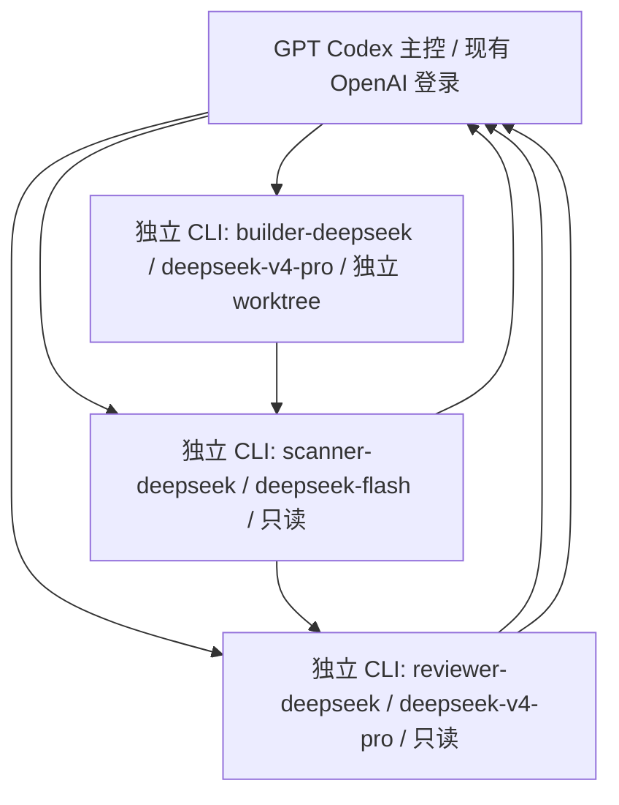

<!-- LADS3_FOCUSED_LIVE_ACCEPTANCE_20261104 -->
# 2026-11-04 当前已实测路由

GPT 主控仍为 OpenAI / gpt-6-astra，登录未变。Scanner、Reviewer、Builder、QA Tester 分别通过 scanner-deepseek、reviewer-deepseek、builder-deepseek、qa-tester-deepseek 独立 CLI profile 使用 lifeos_deepseek / deepseek-flash，四个专用环境变量供各自父进程认证，工具环境排除密钥；未静默调用 GPT 或原生子 Agent。

独立 UI 任务 feeecd97-cbae-4fdc-8a95-fd26051b8609 已完成八调用和实际工具/QA/返工/最终审批，交付状态 DELIVERY_READY；元数据含实际模型、权限预检、时间、token 和不可变 stage SHA。各角色只读/写模式与现有权限边界不变，Builder 在私有 Git worktree 只改 index.html。不能仅以 Agent TOML 的 model 字段声明跨 Provider。

原生 Hook 测试是主控 OpenAI 回合，另行验证了真实 Pre/Post/Stop，不属于 DeepSeek 失败后的模型替换。外部 DeepSeek worker_completed 与原生 SubagentStop 分开。本轮 UI 补验无需再用主控模拟独立审批；协调器接收层修复仍如实记为用户批准的主控工程例外。旧的缺密钥、Pro 分配和未接入描述保留为历史。

以下保留此前快照；与本节冲突的旧 PENDING/BLOCKED 只代表当时状态。

# GPT 主控与 DeepSeek 工作进程路由

更新：2026-11-02。状态：**已准备配置；缺少密钥，真实接入阻塞，未验收**。
本页描述开发团队，与 docs/AI/ 的 Life OS 产品运行时 Agent 设计分开。



图为目标调用关系，当前没有成功的 DeepSeek 请求。主控不会切换 Provider。

## 实际配置

- CLI 实测 `0.166.0-alpha.5.1`；`codex --help` / `codex exec --help` 支持 `--profile`、`--sandbox`、`--json`、stdin、`--no-daemon` 和独立 profile 文件。
- 用户目录 `C:/Users/Administrator/.codex/` 新增 `scanner-deepseek.config.toml`、`reviewer-deepseek.config.toml`、`builder-deepseek.config.toml`、`lifeos-deepseek-models.json`。全部在 Git 仓库外；仅引用环境变量，不包含密钥。
- Provider ID `lifeos_deepseek`，地址 `https://api.deepseek.com`，`wire_api = "responses"`，`env_key = "DEEPSEEK_API_KEY"`，`requires_openai_auth = false`。
- 模型目录从 DeepSeek 官方 Codex 手动配置页提取 JSON；只供三个独立 profile 使用。未运行官方一键安装脚本。
- 主配置 `C:/Users/Administrator/.codex/config.toml` 未修改，SHA-256：`2d97bc7383be2679875695e0e704f7b277c1d9009bec9f93b80ca49438b9883f`；默认 Provider OpenAI，配置模型 gpt-6-astra。未读写 auth.json、登录凭据。
- `.codex/agents/*.toml` 保留角色定义，附路由限制；不能凭 model 名称实现跨 Provider。独立进程使用 `.codex/worker-prompts/*.md`。Reviewer 状态改为 APPROVED / CHANGES_REQUESTED / BLOCKED。

## 当前可执行的离线检查

在本工作树运行：

```powershell
python scripts/lifeos-deepseek.py scanner --check
python scripts/lifeos-deepseek.py reviewer --check
python scripts/lifeos-deepseek.py builder --check
```

这是配置检查器，不是已经验收的任务调度器。未带 `--check` 时明确拒绝运行；不会调用 GPT 或 DeepSeek。`--task-file`、`--workspace` 为后续入口预留，当前没有任务执行能力。检查器会校验模型/端点/认证引用/权限/目录，构造显式路由参数并禁用多层配置中发现的 MCP、apps/plugins；检测 hooks 时停止准备。构造命令不等于有效运行时配置已完整验证。Builder 当前离线检查不创建工作区、不证明 write 权限。

旧 `scripts/lifeos-team.py` 是上轮未验收的 GPT 继承适配器，保留原件，不应用于本轮 DeepSeek 流程。

## 安全配置密钥与下一步验收

1. 在 Windows 搜索“编辑账户的环境变量”，新建用户变量 `DEEPSEEK_API_KEY`，值只在本机填写。不要发到聊天、截图、脚本、命令行参数或 Git；不使用 `setx ...真实密钥` 留下命令历史。
2. 退出并重新打开 Codex/终端，让新进程继承变量；只检查变量是否存在，不打印内容。
3. 用无个人内容的极小请求验证官方 `/responses`，核对响应 model、usage、错误和限流；请求成功前不得声称连通。
4. 三个独立 profile 分别在合成测试仓库验证文件读取、目录、Shell、只读 Git、apply_patch、测试运行、结构化报告和多轮交接。MCP 默认禁用，未来仅逐个验证后按需放开。
5. 核对真实 CLI 会话 Provider/模型和网络端点，不能仅以模型自述或配置文件证明请求到达 DeepSeek。GPT 不作失败兜底。
6. 在独立 Git worktree 验证 Builder 写入及越界拒绝；不把普通 worktree 本身当成只读隔离。真实数据和生产工作区不参与测试。
7. 通过后再完善并启用真实启动器及主控状态机。复杂任务按图顺序进行；CHANGES_REQUESTED 最多三轮，BLOCKED 立即停止交主控；不自动整合、不推送、不部署。

每次请求记录 TASK_ID / AGENT_NAME / MODEL_PROVIDER / MODEL_NAME / START_TIME / END_TIME / INPUT_TOKENS / OUTPUT_TOKENS / TASK_STATUS。usage 不可得时 null。当前没有请求，token 与实际费用均无数据，不能伪造日志。会话原始上下文不作为可提交报告。

## 成本示例（美元）

按官方 2026-11-02 价格、每角色 10 万未命中输入 + 1 万输出 token：Scanner $0.021–0.042，Reviewer/Builder 各 $0.0858–0.1716，三角色一轮约 $0.1926–0.3852。实际费用受缓存、峰谷时段、往返轮数和上下文重复影响；三轮等量请求约 $0.5778–1.1556。不是报价或已发生费用，GPT 主控及额外检索费用另计。

## 证据与未完成项

- 当前工作区：`C:/Users/Administrator/.codex/worktrees/750c/Life OS`，分支 `LADS，自主研发管理系统`，HEAD `aea9e758baac88c310319f34a77f94f2364b0c11`；与 D:/CODEX/Life OS 主工作区分开，不能把本次文件称为已同步主目录/GitHub。
- 修改前副本及全工作区非忽略文件哈希：`backups/pre-deepseek-20261102-162011/`。保留其他任务九份文档与 docs/AI 的已有改动；只追加本轮记录。
- 本轮由 GPT 主控进行用户明确要求的配置准备，不冒充 DeepSeek Builder 执行；独立 DeepSeek Scanner/Reviewer/Builder 审查均未完成。此前 GPT 角色测试不能计作 DeepSeek 验收。
- 未测试：真实 API、八项模型工具、实际 token 用量、DeepSeek 只读会话、Builder 模型写入、三轮返工及交回主控。缺少密钥时停止所有 API 测试。
- 未接触业务代码、浏览器存储、数据库或真实 JSON；未重新验证浏览器 JSON 备份与恢复，不宣称已备份真实数据。未提交、推送、部署、安装依赖。

来源：[DeepSeek Codex 手动配置](https://api-docs.deepseek.com/quick_start/agent_integrations/codex/)、[Responses API](https://api-docs.deepseek.com/api/create-response/)、[模型价格](https://api-docs.deepseek.com/quick_start/pricing/)、[Codex 配置参考](https://learn.chatgpt.com/docs/config-file/config-reference)。


## 本轮实际验证结果

| 项目 | 实际结果 |
| --- | --- |
| 三个 profile 的 TOML、模型目录、端点/环境变量引用 | 离线检查通过；不等于服务端可达 |
| 三角色本地 prompt 权限预检 | 3/3 返回成功，读取到预期 sandbox 与 never；无 API 请求 |
| 主 OpenAI 配置 | 前后 SHA-256 一致，登录文件未读写 |
| 业务与其他任务改动保护 | 备份基线中非允许文件哈希全部一致；追加文档保留原字节前缀 |
| 新 Python 语法、三角色 TOML、git diff --check | 通过；缺少密钥时实时派发入口拒绝运行 |
| Windows 只读合成写入探针 | 写入被拒绝，文件未创建；仅 OS 测试，不是 DeepSeek 调用 |
| 独立 worktree 的 workspace-write 写入探针 | **失败：UnauthorizedAccess，文件未创建**。更换 cwd 后仍拒绝，不放宽沙箱。sandbox 子命令的 -C 另要求 permission-profile；该参数尝试失败，不算权限测试通过 |
| Builder 越界拒绝 | 探针被拒绝，但因合法写入尚失败，不能据此宣称完整工作区隔离已通过 |
| DeepSeek API、八项工具、模型路由实证、返工交接 | **尚未测试：无 DEEPSEEK_API_KEY；Builder 权限另有阻塞** |

忽略的本地证据：`work/deepseek-preparation.json`、`work/deepseek-local-preflight.json`、`work/deepseek-permission-tests.json`。
独立合成工作树保留在 `C:/Users/Administrator/.codex/worktrees/750c/LifeOS-DeepSeek-validation-20261102-162424`，未创建提交，未整合回项目。未使用绕过沙箱参数。

下一步先安全配置密钥，再解决 CLI 0.166 的 Builder 有效写权限；不把原生子 Agent、旧 GPT 结果或配置自检当成 DeepSeek 实证。本轮不能标记混合团队验收完成。


## 2026-11-02 独立角色密钥增量（覆盖上方通用变量说明）

三个 profile 已分别引用 `DEEPSEEK_SCANNER_API_KEY`、`DEEPSEEK_REVIEWER_API_KEY`、`DEEPSEEK_BUILDER_API_KEY`。用户曾在聊天提供密钥；不复制、不使用聊天中的值、不写入报告，建议在 DeepSeek 控制台撤销并生成替代密钥。本轮未发起 API 请求。

本机输入脚本：`scripts/set-deepseek-role-keys.ps1`。在本地 PowerShell 运行 `& ".\scripts\set-deepseek-role-keys.ps1"`，隐藏输入三枚新密钥，所有输入通过格式检查后保存为 Windows 用户环境变量；失败尝试恢复旧值。该存储不是加密保险箱，当前用户或有相应权限的进程可读取。脚本不打印值、不接收命令行密钥、不写密钥文件。重新打开 Codex 和终端后才能继承变量。

只验证了脚本语法、profile 引用和离线检查；没有执行隐藏输入、保存真实密钥、API 或工具验收。Builder 写权限的上轮阻塞仍未解决，实时调度保持关闭。


## 2026-11-02 DeepSeek 真实验证增量

Reviewer/Builder 独立环境变量的官方 API 均200；实际CLI读取/Git/评审、apply_patch、1个合成测试通过，Reviewer写入拒绝、Builder独立worktree内写入成功/越界拒绝已复核。Scanner仍401，用户正在本地更新；MCP及完整全链路未验收。主控仍OpenAI；用户配置哈希期间变化，未覆盖，原因待确认。旧“缺密钥/Builder写入未证实”是历史状态，以本轮结果为准；离线检查器仍未开放实时派发。详见 [实际验证报告](DEEPSEEK-VALIDATION-20261102.md)。本轮只追加文档，不改业务/数据，不推送/部署。


2026-11-02 最新检验：Scanner 新密钥已200；三角色独立API/CLI个体工具和权限实测通过，Reviewer汇总复核个体验收APPROVED。仅人工交接的合成测试；自动三轮调度、完整新任务链路、MCP及生产启动器仍未验收。详见 [最新实测增量](DEEPSEEK-VALIDATION-20261102.md#2026-11-02-17时补验scanner-恢复三角色个体验收通过)。无业务/用户数据变更，不提交/推送/部署。


## 2026-11-02 最新开发模型：三角色均 DeepSeek-V4.1-Flash

按用户批准，Reviewer/Builder 从 deepseek-v4-pro 改为 deepseek-flash（官方展示名 DeepSeek-V4.1-Flash）；Scanner profile不变，GPT/OpenAI主控与登录不变。两角色API均200；新的合成任务串行完成扫描→方案APPROVED→Builder apply_patch/3测试→复扫→最终APPROVED，并复核Builder内写/越界拒绝、Reviewer直接写入拒绝。可受控人工调度；生产自动启动器、三轮自动返工及MCP仍未验收，离线检查门禁保留。主config哈希期间变化但当前仍gpt-6-astra/OpenAI，原因待确认，不覆盖恢复。旧Pro分配保留为历史。详见 [Flash切换验收](DEEPSEEK-FLASH-ACCEPTANCE-20261102.md)。
